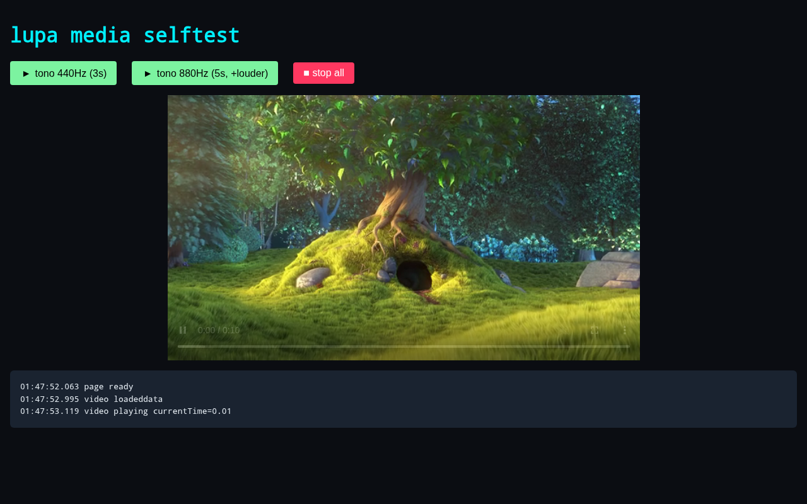

# Lupa

[Extensiones y complementos: Dedo, Cinder, Lumbre, Mutus, Tinta y Vimium](docs/EXTENSIONS.md).

Versión 0.0.3. [Cambios por versión](CHANGELOG.md) · [Imagen Docker y actualización](docs/RELEASES.md).
La distribución preparada para AMD64 es `bunxdev/lupa:0.0.3`; la receta siguiente
conserva el despliegue desde código sobre la base original de Selkies.

Lupa es un servicio de automatización de Chromium con API HTTP, acceso CDP autenticado y una sesión visual persistente transmitida por Selkies WebRTC. Incluye audio, perfiles persistentes, descargas al host, carga de extensiones, captura de pantalla y contenido, render de HTML, PDF, evaluación JavaScript y controles de sesión en vivo.



## Arquitectura

- `ghcr.io/linuxserver/baseimage-selkies:debiantrixie`: escritorio, nginx, Selkies, PulseAudio, openbox y s6-overlay.
- Bun y TypeScript: API HTTP.
- Playwright Chromium: navegador headless para trabajos aislados y contexto persistente headed para `/live`.
- `/config`: volumen persistente con binarios, cache de Playwright, preferencias y perfiles.
- `/extensions`: overlay de extensiones desempaquetadas, montado read-only.
- `/config/Downloads`: bind mount de descargas recuperables desde el host.

## Requisitos

- Docker Engine con el plugin Compose.
- Al menos 2 GiB libres para la imagen y las dependencias del primer arranque.
- Un token aleatorio de 32 caracteres como mínimo. Se recomienda generar 32 bytes:

```sh
cp .env.example .env
openssl rand -hex 32
```

Coloque el resultado en `LUPA_API_TOKEN` dentro de `.env`. El archivo está ignorado por Git. Lupa rechaza el arranque si falta el token o es evidentemente débil.

## Build Y Arranque

La imagen base se obtiene del registry y los scripts idempotentes de `custom-cont-init.d/` instalan Bun, dependencias del sistema y Chromium. Bun, navegadores y perfiles quedan cacheados en el volumen `/config`; el primer arranque es considerablemente más lento que los siguientes.

```sh
docker compose pull
docker compose up -d
docker compose logs -f lupa
curl http://127.0.0.1:3036/health
```

Para actualizar dependencias declaradas por la aplicación en una instancia levantada:

```sh
docker compose exec lupa bash -lc 'cd /app && bun install --frozen-lockfile'
```

No se necesita publicar ningún puerto para que los procesos del contenedor se comuniquen. Compose escucha por defecto sólo en `127.0.0.1` del host.

## Variables

| Variable | Predeterminado | Uso |
|---|---:|---|
| `LUPA_API_TOKEN` | vacío | Bearer obligatorio; mínimo 32 caracteres y 8 caracteres distintos. |
| `LUPA_API_TOKEN_FILE` | vacío | Alternativa read-only a la variable; contiene el token. Tiene prioridad. Requiere montar el archivo mediante un override Compose. |
| `LUPA_MAX_BODY_BYTES` | `5242880` | Límite de JSON, entre 1 KiB y 16 MiB. |
| `LUPA_API_BIND` | `127.0.0.1` | Dirección del host donde se publica la API. |
| `LUPA_API_PORT` | `3036` | Puerto de API en el host. |
| `SELKIES_BIND` | `127.0.0.1` | Dirección del host donde se publica Selkies. |
| `SELKIES_PORT` | `6080` | Puerto Selkies en el host. |
| `SELKIES_USER` | `lupa` | Usuario de acceso a Selkies. |
| `SELKIES_PASSWORD` | vacío | Password de Selkies. Defínalo antes de ampliar el bind. |
| `LUPA_HOSTNAME` | `lupa` | Hostname interno del contenedor. |
| `PUID`, `PGID` | `911` | Identidad usada por la imagen base. |

Al ejecutar la aplicación fuera de Compose, `API_HOST` vale `127.0.0.1` y `PORT` vale `3000`. Compose usa `API_HOST=0.0.0.0` sólo dentro de la red aislada del contenedor y restringe la publicación del host a loopback.

## Autenticación

`GET /health` y `GET /selftest` son públicos. `/selftest` debe ser navegable directamente desde la sesión headed para comprobar multimedia. Todo endpoint restante, incluidos estado, cookies y capturas live, requiere:

```text
Authorization: Bearer <LUPA_API_TOKEN>
```

Ejemplo:

```sh
set -a; . ./.env; set +a
curl -X POST http://127.0.0.1:3036/screenshot \
  -H "Authorization: Bearer $LUPA_API_TOKEN" \
  -H 'Content-Type: application/json' \
  --data '{"url":"https://example.com","fullPage":true}' \
  --output example.png
```

## Endpoints

Todos los cuerpos indicados son objetos JSON con `Content-Type: application/json`.

| Método | Ruta | Cuerpo principal | Respuesta |
|---|---|---|---|
| `GET` | `/health` | ninguno | `{ "ok": true }` |
| `GET` | `/selftest` | ninguno | Página pública de prueba de video y WebAudio. |
| `POST` | `/screenshot` | `{ url, viewport?, fullPage?, format?, selector?, waitFor? }` | PNG o JPEG. |
| `POST` | `/render` | `{ html, viewport?, fullPage?, format? }` | PNG o JPEG. |
| `POST` | `/pdf` | `{ url, format?, landscape? }` | PDF. |
| `POST` | `/eval` | `{ url, script }` | Resultado, consola y errores de página. |
| `POST` | `/content` | `{ url }` | HTML final de la página. |
| `POST` | `/extension/run` | `{ extension, url, script?, screenshot?, waitFor?, fresh?, viewport? }` | Resultado y captura base64 opcional. |
| `POST` | `/live` | `{ url, viewport? }` | Abre la URL en la sesión visual persistente. |
| `GET` | `/live` | ninguno | Estado y URL de la sesión. |
| `GET` | `/cdp/json/version` | ninguno | Metadatos Chromium y URL WebSocket CDP. |
| `GET` (WebSocket) | `/cdp` | mensajes CDP | Conexión al navegador de la sesión visual. |
| `POST` | `/live/close` | ninguno | Cierra el contexto live. |
| `POST` | `/live/eval` | `{ script }` | Evalúa JavaScript en la página live. |
| `POST` | `/live/click` | `{ selector }` | Click por selector. |
| `POST` | `/live/mouse-click` | `{ x, y, button? }` | Click por coordenadas. |
| `POST` | `/live/mouse-move` | `{ x, y }` | Mueve el cursor. |
| `POST` | `/live/type` | `{ text }` | Escribe texto. |
| `POST` | `/live/key` | `{ key }` | Envía una tecla Playwright. |
| `POST` | `/live/screenshot` | ninguno | PNG del viewport actual. |
| `GET` | `/live/cookies` | ninguno | Cookies del contexto live. |
| `POST` | `/live/cookies/add` | `{ cookies }` | Añade entre 1 y 200 cookies Playwright. |

`viewport` admite enteros entre 64x64 y 7680x4320. Los scripts tienen un máximo adicional de 256 KiB. El límite total de cuerpo evita cargas sin cota, pero sigue permitiendo renderizados HTML grandes.

## CDP: conectar herramientas al Chromium de Lupa

CDP (Chrome DevTools Protocol) está disponible en `ws://127.0.0.1:3036/cdp`. Usa el mismo token Bearer que la API, tanto para el descubrimiento HTTP como para el handshake WebSocket. No hace falta publicar un puerto 9222: Chromium escucha en un puerto dinámico del loopback del contenedor y Lupa retransmite la conexión autenticada.

El cliente accede al navegador **live**, con sus pestañas, cookies, perfil y extensiones. Las pestañas del contexto persistente aparecen en Selkies. Los endpoints `/live/*` siguen controlando la página que administra Lupa; crear otra pestaña mediante CDP no cambia esa selección. Los trabajos HTTP aislados, como `/eval` y `/screenshot`, conservan sus contextos independientes.

Con Playwright, desde un proceso que tenga acceso a la API y el token en su entorno:

```js
import { chromium } from 'playwright';

const browser = await chromium.connectOverCDP('http://127.0.0.1:3036/cdp', {
  headers: { Authorization: `Bearer ${process.env.LUPA_API_TOKEN}` },
});
try {
  const context = browser.contexts()[0];
  const page = await context.newPage();
  await page.goto('https://example.com');
  console.log(await page.title());
} finally {
  await browser.close(); // En connectOverCDP, desconecta este cliente.
}
```

Con Puppeteer:

```js
import puppeteer from 'puppeteer-core';

const browser = await puppeteer.connect({
  browserWSEndpoint: 'ws://127.0.0.1:3036/cdp',
  headers: { Authorization: `Bearer ${process.env.LUPA_API_TOKEN}` },
  defaultViewport: null,
});
try {
  console.log((await browser.pages()).map(page => page.url()));
} finally {
  browser.disconnect();
}
```

Para otras herramientas, configura la URL WebSocket y el encabezado `Authorization`. La ruta de descubrimiento es `GET /cdp/json/version` y también admite barra final, como requiere Playwright. El gateway expone el endpoint de navegador; los targets se enumeran mediante CDP, sin implementar `/json/list` ni el frontend de DevTools. Detrás de un proxy TLS, usa directamente `wss://tu-host/cdp` y habilita el forwarding de WebSocket y Authorization.

Desconectar el transporte deja la sesión abierta. Un comando CDP `Browser.close` (incluido `browser.close()` de Puppeteer) sí cierra el navegador compartido, igual que `POST /live/close`; los clientes pierden la conexión y deben reconectarse. La siguiente conexión inicia Chromium de nuevo con el perfil persistente. CDP concede control completo sobre esa sesión a quien posea el token.

Después de actualizar el código de una instancia que ya está ejecutándose, aplica el cambio con `docker compose restart lupa`; esto reinicia la sesión visual. Para desarrollo y pruebas puede elegirse otro perfil mediante `LUPA_LIVE_PROFILE` (por defecto `/config/live-profile`); en Compose se configura con un override de `environment`.

## Browser Use en la sesión visual

La [integración Browser Use](integrations/browser-use/README.md) permite que un asistente controle la misma pestaña de `/live` mientras observas los movimientos en Selkies. Incluye una demo pausada y comandos de navegación, inspección, clic, escritura, scroll y captura, sin necesitar un proveedor de modelos.

```sh
python3 integrations/browser-use/run.py demo
```

Abre `http://localhost:6080` para seguirla en directo. El cliente se desconecta al terminar y deja Lupa abierta.

## Sesión Visual Y Audio

Abra una página y después visite Selkies:

```sh
curl -X POST http://127.0.0.1:3036/live \
  -H "Authorization: Bearer $LUPA_API_TOKEN" \
  -H 'Content-Type: application/json' \
  --data '{"url":"http://127.0.0.1:3036/selftest"}'

xdg-open http://127.0.0.1:6080/
```

Selkies transmite el display con redimensionado, teclado, ratón, portapapeles y audio. El servicio s6 prepara un sink PulseAudio antes de Chromium para que WebAudio funcione incluso si el cliente WebRTC se conecta después.

Para proteger la interfaz, defina `SELKIES_USER` y un `SELKIES_PASSWORD` fuerte. Si se publica fuera de loopback, use además un proxy de confianza con TLS y controles de acceso; WebRTC puede necesitar configuración de red adicional según el entorno.

## Persistencia, Extensiones Y Descargas

- El volumen Compose `lupa_config` conserva `/config`, incluido `live-profile`, `ext-profiles`, Bun y la cache de Chromium.
- `./extensions:/extensions:ro` es el punto de overlay reservado. Añada extensiones privadas como `extensions/<nombre>/manifest.json`; sus contenidos están ignorados por Git.
- `/extension/run` sólo acepta nombres `[A-Za-z0-9_-]` y usa un perfil independiente por extensión.
- La sesión live descubre todas las extensiones válidas al crear su contexto. Use `/live/close` y vuelva a abrirla para recargar cambios.
- `./downloads:/config/Downloads` conserva las descargas fuera del volumen y está ignorado por Git.

No incluya extensiones privadas, perfiles, descargas ni `.env` en imágenes o publicaciones. Para mounts externos, cree un archivo Compose override local sin versionarlo y mantenga los destinos `/extensions`, `/config` y `/config/Downloads`.

## Despliegue Side-by-side

Use nombres de proyecto y puertos distintos. Al no fijar `container_name`, Compose separa contenedores y volúmenes automáticamente:

```sh
LUPA_API_TOKEN="$(openssl rand -hex 32)" \
LUPA_API_PORT=3136 SELKIES_PORT=6180 \
docker compose -p lupa-secondary up -d
```

No use el mismo directorio de descargas o extensiones privadas si las instancias deben quedar aisladas; configure overrides separados.

## Seguridad

- Mantenga API y Selkies en loopback salvo necesidad explícita.
- Trate `/eval`, `/live/eval`, `/render` y las extensiones como ejecución de contenido no confiable.
- El token no se escribe en logs ni en respuestas. Los errores internos se reducen a tipo genérico para no registrar URLs o datos de página.
- El token protege la API, no sustituye TLS cuando cruza una red.
- La API puede alcanzar URLs visibles desde el contenedor. Aplique filtrado de egress si usuarios no confiables pueden enviar trabajos para limitar SSRF.
- Chromium usa `--no-sandbox` por compatibilidad con el contenedor. No considere el navegador una frontera de aislamiento fuerte.
- Revise permisos de `downloads`, extensiones y volumen persistente, donde pueden existir cookies y sesiones.

## Pruebas

```sh
docker compose exec lupa bash -lc 'cd /app && bun test && bunx tsc --noEmit'
docker compose config --quiet
git diff --check
```

La integración CDP usa Chromium real, dos clientes simultáneos y una instancia temporal de la API con un perfil separado. Comprueba autenticación mediante archivo, navegación compartida, cookies, captura y reconexión tras cerrar la sesión:

```sh
docker compose exec --user abc \
  -e HOME=/config -e DISPLAY=:1 \
  -e PLAYWRIGHT_BROWSERS_PATH=/config/.cache/ms-playwright \
  -e RUN_BROWSER_TESTS=1 lupa \
  /config/.bun/bin/bun test --cwd /app
```

El autotest manual está en `http://127.0.0.1:3036/selftest`: comprueba reproducción de video y genera tonos con WebAudio. Para una prueba completa, ábralo mediante `/live`, entre en Selkies y confirme imagen y audio.

Consulte [Camino.md](Camino.md) para la evolución técnica y decisiones de compatibilidad.

### Prospección local con Lupa

La integración Browser Use incluye un recolector reutilizable de contactos públicos de Google Maps con filtros por municipio y categoría, deduplicación, reanudación y exportación CSV/JSON/HTML. Consulta los [comandos y requisitos](integrations/browser-use/README.md#contactos-locales-desde-google-maps) y la [skill lupa-local-leads](skills/lupa-local-leads/SKILL.md).

## Laboratorio de cinco navegadores

La rama `testing` incluye [un laboratorio](lab/README.md) con Lupa, Obscura, Lightpanda, BrowserOS y agent-browser, siguiendo el patrón de Compose y scripts de `nyaweb/micro`.

En máquinas con memoria limitada, prueba un servicio por turno:

```sh
./lab/lab stop
./lab/lab up -d --no-deps obscura
# Ejecuta las pruebas del servicio antes de detenerlo.
./lab/lab stop obscura
./lab/lab up -d --no-deps lightpanda
```

Detén también cualquier instancia de navegador iniciada desde otro proyecto Compose antes de medir. Los nombres de servicio disponibles son `lupa`, `obscura`, `lightpanda`, `browseros` y `agent-browser`.

### Resultados de la comparación secuencial — 15 de septiembre de 2026

Se probó Lupa slim como referencia y cada navegador alternativo por separado, deteniendo el anterior antes de iniciar el siguiente. La página local compartida comprobó JavaScript, `fetch`, formularios, canvas, cookies, `localStorage`, capturas y PDF. También se comprobó navegación HTTPS a example.com.

| Servicio probado | RAM observada tras las pruebas | Resultado y posible aportación a Lupa |
|---|---:|---|
| Lupa slim / Chromium 147.0.7727.15 | 783 MiB | Pasó las pruebas comunes; conserva Chromium como base para compatibilidad y sesión visual. |
| Obscura 0.2.2 | 60 MiB | Ejecutó JS, formularios y canvas; generó PNG/PDF y conservó cookies. Perdió `localStorage` al recargar. Candidato experimental para trabajos cortos de extracción y renderizado. |
| Lightpanda nightly 9448+baf45f03e | 27 MiB | Pasó extracción, formularios y almacenamiento. Generó PNG/PDF, pero la captura fue textual y el canvas no reprodujo los píxeles esperados. Candidato para extracción de datos bajo demanda. |
| BrowserOS 0.50.3 / Chromium 151.0.8160.137 | 1,32 GiB | Pasó las pruebas comunes y su backend informó conexión CDP operativa. Interesan sus herramientas y orquestación; incorporar el navegador completo no ayuda a reducir recursos. |
| agent-browser 0.37.1 / Chromium 152.0.7977.82 | 483 MiB | Pasó las pruebas y produjo snapshots con referencias a campos y botones. Interesa reutilizar esas acciones sobre el CDP de Lupa. |

La RAM corresponde a muestras de `docker stats`, no a máximos. Lupa y BrowserOS incluyen escritorio y servicios adicionales; agent-browser incluye su Chromium, daemon y dashboard. No son cargas equivalentes ni una predicción del consumo en sitios complejos. Generar PNG/PDF no garantiza fidelidad visual respecto a Chromium.

Una segunda ronda confirmó conexión Playwright, creación de contextos y clic por rol en Obscura y Lightpanda. En Obscura, la pérdida de `localStorage` se reprodujo tres veces: lectura inmediata correcta y `null` después de recargar. Las cookies sí sobrevivieron la recarga; esto no demuestra persistencia entre reinicios.

**Recomendación:** mantener Chromium como motor predeterminado; evaluar agent-browser reutilizando el navegador existente y Lightpanda como servicio opcional para extracción. La integración autenticada de agent-browser con el WebSocket Bearer de Lupa todavía no está validada. Obscura puede servir para tareas acotadas que no dependan de `localStorage`, pero debe seguir experimental hasta resolver ese fallo y ampliar las pruebas. Estas propuestas no son motores alternativos ya integrados en la API de Lupa. No se evaluó razonamiento de agentes con modelos de IA ni aplicaciones autenticadas reales.

## Imagen optimizada publicada en Docker Hub

La variante construida en el proyecto `debina` está publicada en [Docker Hub](https://hub.docker.com/r/bunxdev/lupa/tags):

```sh
docker pull bunxdev/lupa:slim-20260915
```

- Plataforma publicada y probada: `linux/amd64`.
- Digest verificado después de publicar y descargar de nuevo: `sha256:d7c94e9360e2b9d258b4cf659e586517a7b635a132e0e7b4694fb85d138cf6f6`.
- Capas comprimidas: aproximadamente **656 MB de descarga**.
- Tamaño local reportado por Docker: **2,27 GB**, frente a **3,87 GB** de la imagen base original en la misma máquina. La variante slim incluye navegador y dependencias; la base original descarga parte de ellos al arrancar.

La imagen reutiliza un único binario completo de Chromium para los trabajos headless y la sesión visual. Las pruebas específicas verificaron API, CDP autenticado, aislamiento, extensiones, persistencia de perfiles, descargas y escritorio Selkies con vídeo, audio, teclado, ratón, portapapeles y redimensionado. También se verificó arranque sin red y conservación de cookies y descargas al recrear el contenedor.

Los archivos Compose y scripts descritos al principio de este README siguen correspondiendo al despliegue original de este repositorio. La imagen slim tiene su propia receta en `debina`; no basta con sustituir la imagen del Compose original, que monta scripts y dependencias para otra distribución. La instancia slim usada en estas pruebas publicó la API/CDP en `3136` y el escritorio en `6180`; el despliegue original conserva los valores `3036` y `6080`.

## MCP para Codex, OpenCode y Claude

El [servidor MCP de Lupa](integrations/mcp/README.md) expone 21 herramientas por
stdio para navegar e investigar en la sesión visible, inspeccionar controles,
hacer clic, escribir, evaluar JavaScript, extraer contenido y generar capturas/PDF.
Reutiliza la API autenticada y el Chromium existente. Incluye configuraciones
para Codex, OpenCode y Claude Code/Desktop, y pruebas de protocolo y navegador.
Se ejecuta como integración local; no modifica la imagen Docker Hub ya publicada.

## LupaX y Voxy

La rama `lupax` guarda el estado técnico, pruebas y decisiones en
[docs/LUPAX.md](docs/LUPAX.md), junto con las [recetas de Lupa slim](deploy/slim/README.md).
[Voxy](https://github.com/bunxdev/voxy) es un proyecto separado para ejecutar
Debian mínimo dentro de QEMU; Docker y Lupa serán integraciones posteriores.
